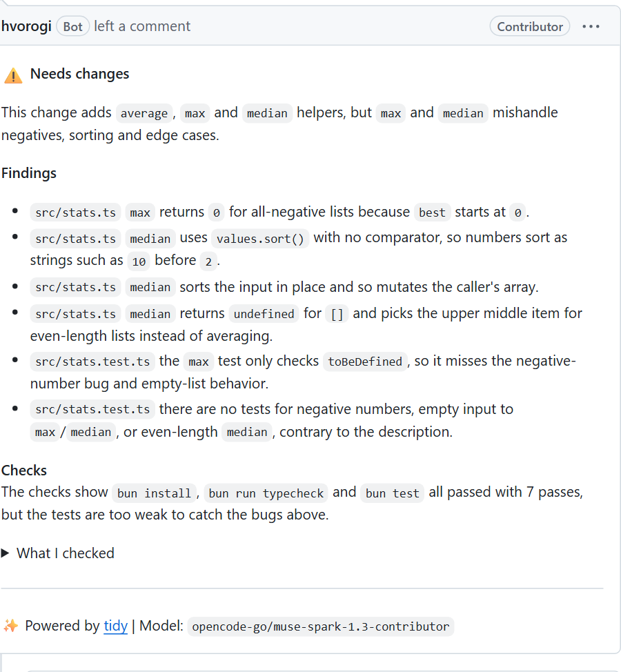
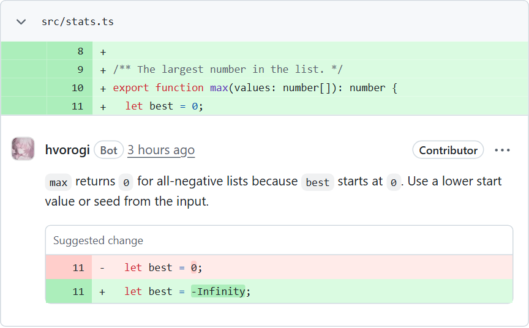
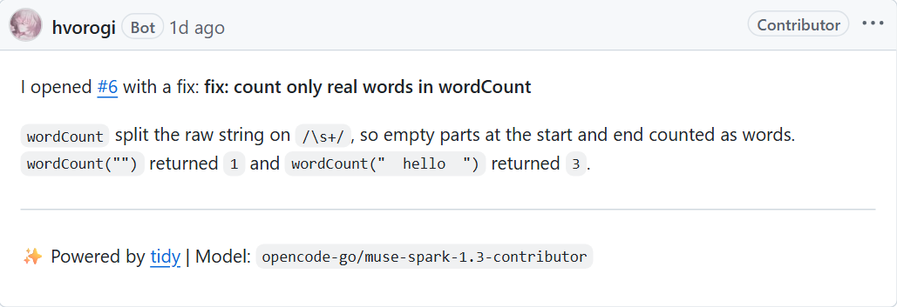

<p align="center">
  <picture>
    <source media="(prefers-color-scheme: dark)" srcset="assets/banner-dark.svg">
    
  </picture>
</p>

A GitHub bot you run yourself. tidy triages new issues, answers questions, proposes fixes as pull
requests and reviews pull requests. It runs on GitHub Actions and a free Cloudflare Worker, it never
pushes to your default branch, and no repository needs a secret.

**Try it in [tidy-playground](https://github.com/igorovh/tidy-playground):** open an issue about one of its
bugs and watch tidy triage it, open a fix and review it.

## What it does

- **Fixes issues.** It reads a new issue, decides what kind it is, and opens a pull request with a fix
  and a test, or answers the question.
- **Reviews pull requests.** A verdict, a short list of findings, and your repository's own checks run on
  the pull request code.
- **Suggests one-click fixes.** Inline comments carry GitHub suggestions for small, certain fixes.
- **Shows the change.** Review extras can attach before and after recordings, such as a GIF of the UI.
- **Follows up.** New commits get a short review of what they fixed and what is still open.
- **Keeps secrets out of reach.** Keys live only in the Worker, and each job gets only what it needs.

<table>
  <tr>
    <td width="50%">
      <picture>
        <source media="(prefers-color-scheme: dark)" srcset="docs/images/review-dark.png">
        
      </picture>
    </td>
    <td width="50%">
      <picture>
        <source media="(prefers-color-scheme: dark)" srcset="docs/images/suggestion-dark.png">
        
      </picture>
      <br><br>
      <picture>
        <source media="(prefers-color-scheme: dark)" srcset="docs/images/issue-fix-dark.png">
        
      </picture>
    </td>
  </tr>
</table>

## Quick start

1. Create your copy with **Use this template**, then run `bun install` and `bunx wrangler login`.
2. Run `bun run deploy` and open the setup link it prints.
3. Click **Create GitHub App** and install the App on your repositories.
4. Save your model key in `/admin`, for example an [OpenCode Go](https://opencode.ai/docs/console/go/) key.
5. Optionally run `bun run protect`, so your default branches require an approved pull request.

The [setup guide](docs/setup.md) explains each step.

## Set up with your coding agent

Paste this into OpenCode, Claude Code or Codex, in a repository where tidy is installed:

```text
Set up tidy for this repository. Read https://raw.githubusercontent.com/igorovh/tidy/main/llms.txt
and the configuration guide it links to, then create .github/tidy.yml with this repository's checks
and open a pull request that explains each choice.
```

There is also a prompt that [installs your own tidy](docs/agent-prompts.md#install-your-own-tidy).

## Commands

Comment on an issue or pull request. Only people with write access can run commands.

| Comment | Effect |
| --- | --- |
| `@tidy fix` | Attempt a fix for an issue |
| `@tidy review` | Review the pull request again |
| `@tidy publish` | Open the pull request for a patch tidy posted for approval |

To have tidy review a pull request it skips, such as one from Renovate, add the `tidy:review` label.

## Documentation

- [Setup](docs/setup.md): install, add repositories, protect branches, costs, updates
- [Configuration](docs/configuration.md): models, routes, checks, limits
- [Review extras](docs/extras.md): before and after recordings
- [How it works](docs/how-it-works.md): the Worker, the workflows and each flow
- [Security model](docs/security.md)
- [Prompts for coding agents](docs/agent-prompts.md)
- [Development](docs/development.md)

## License

[MIT](LICENSE)
