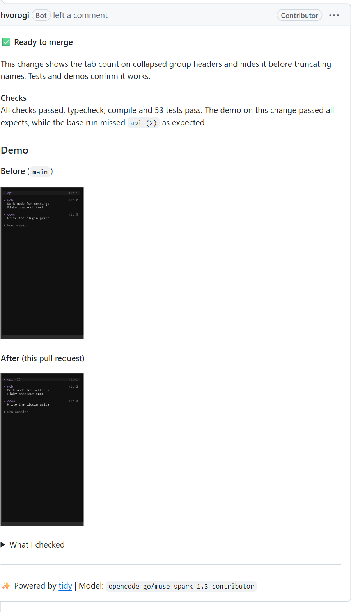

# Review extras

A repository can ask for more than text in its reviews, such as a demo GIF of the changed UI. tidy knows
nothing about the tool. It only runs a command the repository names in `.github/tidy.yml`:

```yaml
review:
  extras:
    - name: Demo
      when: ["src/**"]            # only for pull requests that change these files
      instructions: >-
        Record the changed behaviour. The steps are described in AGENTS.md.
      image: node:22-bookworm
      setup: apt-get install -y ffmpeg && bun install
      command: ["bun", "run", "record", "--", "--out", "{out}/demo.gif"]
```

## What happens

1. A planning step lets the review model read the instructions, the diff and the repository's docs, and
   pick the command's arguments. It must include a check that passes on the pull request and fails on
   the base branch. If no such check is possible, it skips the extra.
2. tidy runs `setup` and `command` with those arguments in a container without secrets, once on the pull
   request and once on the base branch. The container runs as root with network access, so `setup` can
   install packages. The arguments are passed as a list, never through a shell.
3. The files the command writes to `{out}` appear in the review as **Before** and **After**. The model
   sees the command output too, so it can say what changed.

Extras run on pull requests from maintainers. For pull requests from people without write access they
run only when a maintainer comments `@tidy review`, because they run the pull request's code as root.

Files must be GIF, PNG, JPEG, WebP, MP4 or WebM, with names made of letters, digits, `.`, `_` and `-`;
other files are skipped. Each file can be up to 2 MB, and a review takes at most 8 files and 10 MB in
total. Images are shown inline; videos are linked.



## Where the files live

GitHub's attachment upload does not accept App tokens, so tidy keeps these files on a `tidy-assets`
branch in the reviewed repository. The branch is always a single commit holding the last 30 days, so it
adds no history and old files drop out. Its commits say `[skip ci]`, so your push workflows do not run
on it. It is the only branch tidy ever overwrites. In private
repositories the images may not show, because raw files there need a login.

## Example

[opencode-better-tabs](https://github.com/igorovh/opencode-better-tabs/blob/main/.github/tidy.yml)
records its tab bar in the real OpenCode TUI. Its `record` script supports `expect`, `expect-not` and
`expect-above` steps, so a recording fails when the behaviour is wrong, and still writes the GIF.
